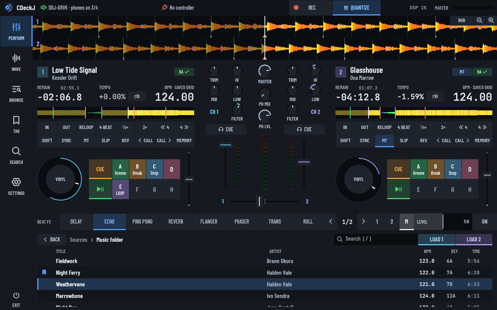
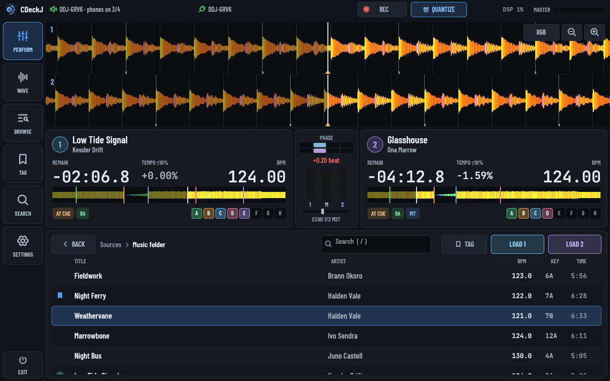
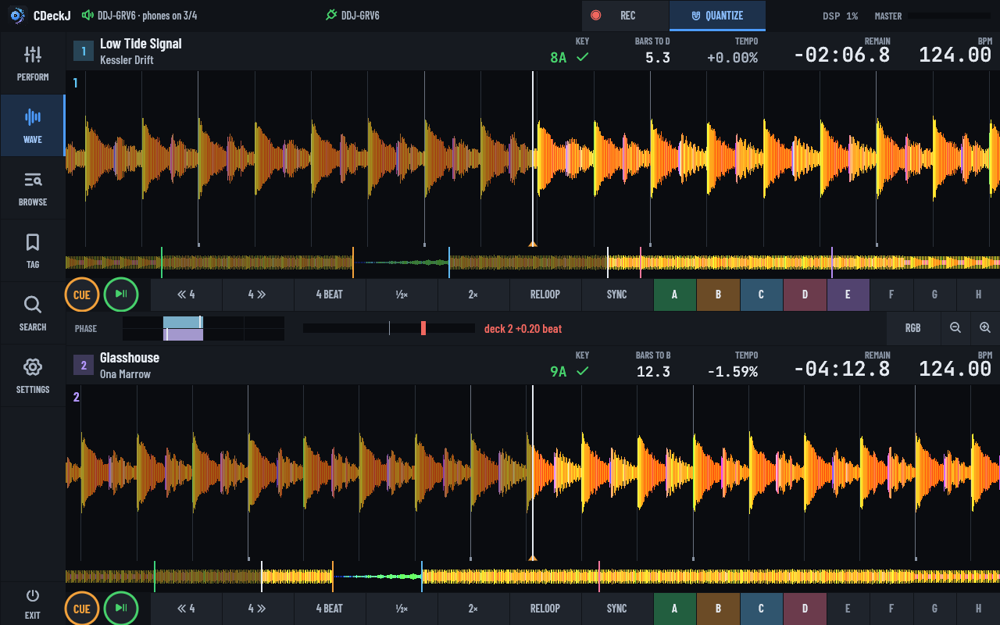
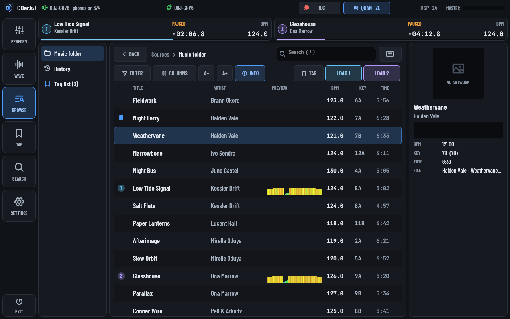
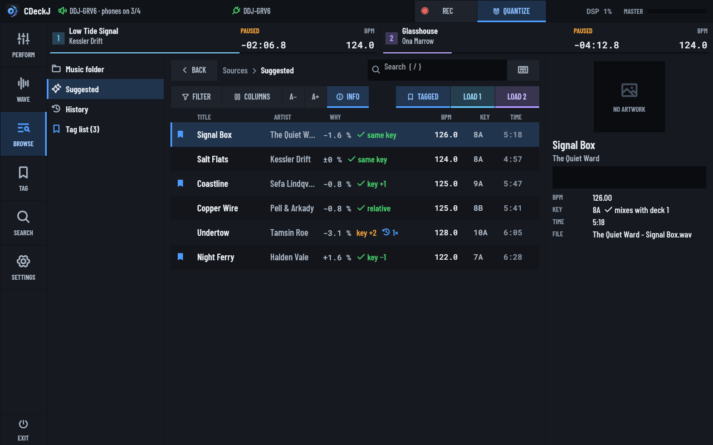
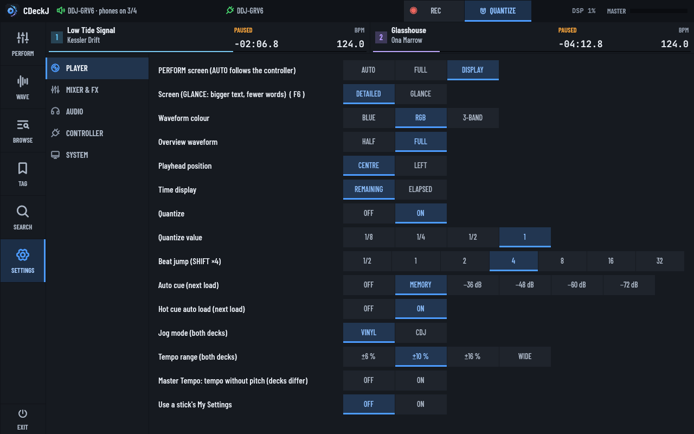
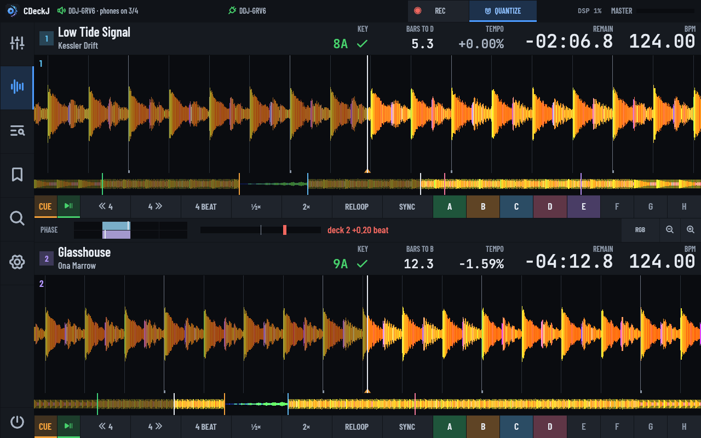
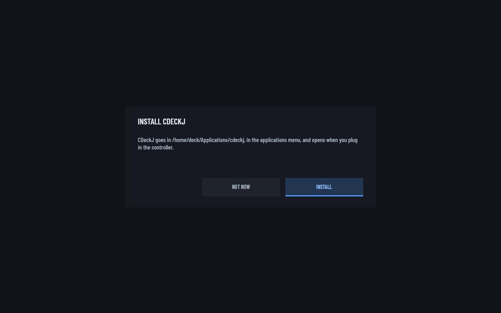
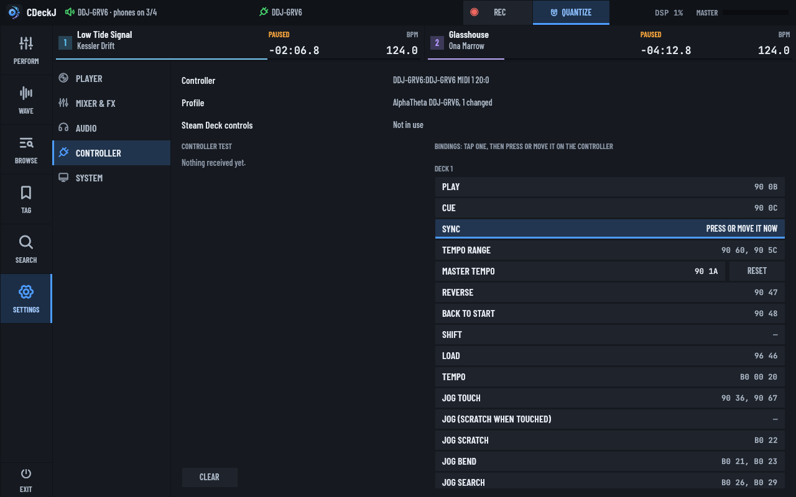

# CDeckJ

A two-deck DJ player that works like a pair of CDJs and a two-channel mixer. It's made for the Steam Deck's touchscreen and the AlphaTheta (Pioneer DJ) DDJ-GRV6. Other DJ controllers work through built-in profiles or MIDI learn, and it also works with touch or a keyboard alone.



## Features

- **CDJ-style decks.** PLAY and CUE behave like the hardware, with 8 hot cues, memory cues, loops, beat jump, slip, reverse, quantize and a vinyl or CDJ jog.
- **Tempo and sync.** ±6 / 10 / 16 % or WIDE tempo ranges, BPM detection, SYNC with phase lock, and Master Tempo (key lock).
- **Mixer.** Trim, 3-band EQ with full kill, filter, channel faders, crossfader and headphone cue.
- **Beat FX.** Delay, echo, ping pong, reverb, flanger, phaser, trans and roll, synced to the beat.
- **rekordbox USB sticks.** Browse playlists and history, and get rekordbox's beat grids, hot cues, memory cues, artwork, waveforms and My Settings.
- **Your own music folder.** Tracks are analysed in the background. MP3, FLAC, WAV, AIFF, OGG and M4A all play.
- **Waveforms** in Blue, RGB or 3-Band, as soon as a track loads.
- **Recording** of the mix to WAV, with a tracklist and CUE sheet.
- **Key matching.** Keys that mix with the other deck show green, and the library can filter by BPM and key.
- **Suggestions.** The library ranked against the playing track by tempo, key and what you've played after it before.
- **Play history and a tag list** for planning the set.
- **Multi-touch.** Hold CUE with one finger and tap PLAY with another, or ride two faders at once.

Not included: more than two decks, a sampler, mic input, key detection for your own files, and saving cues back to a stick.

## Screens

The big buttons down the left switch between screens, like the buttons beside a CDJ's display. F1–F5 work too.

**PERFORM** shows everything when no controller is connected: both decks with jog wheels and pads, the mixer, Beat FX and the library (above). With a controller, the controller has the buttons, so PERFORM becomes a display: big waveforms, readouts, a phase meter and the track list.



**WAVE** shows both waveforms large, for beatmatching and phrasing. It has a phase meter, the bars left to the next cue, and transport, loop and hot cue buttons.



**BROWSE** is the whole library, with search, an on-screen keyboard, sortable columns, a BPM and key filter, and an INFO panel. **TAG** is your tag list.



**Suggested**, in the BROWSE sidebar, ranks the whole library against the leading deck. A track makes the list if its tempo is within 8 % (half and double time count) and its key doesn't clash, or if you've played it straight after this track before, in CDeckJ or on a rekordbox stick. The WHY column shows the tempo change, where the key sits on the wheel, and how often you've played it next. Without Master Tempo, a tempo change moves the key, so keys are compared as they will sound. Tracks already played this session are left out.



**SETTINGS** holds the player and mixer options, the audio output, controller bindings with a live test, and system options.



**Glance mode** is for reading the screen from arm's length. It makes the text and readouts bigger, the track list rows taller, and drops the rail labels and secondary captions. Switch it in SETTINGS → PLAYER → Screen, or with F6.



## Install on the Steam Deck

1. In Desktop Mode, download the [latest release](https://github.com/joeyballentine/CDeckJ/releases/latest/download/cdeckj-steamdeck-x86_64.tar.gz) and extract it.
2. Double-click `cdeckj` in the extracted folder and press **INSTALL**. CDeckJ copies itself to `~/Applications/cdeckj`, adds itself to the applications menu, sets itself to open whenever the controller is plugged in, and restarts from there.
3. For Game Mode, add CDeckJ in Steam with *Games → Add a Non-Steam Game to My Library*. CDeckJ gives the shortcut its library artwork the next time it starts.
4. Put music in `~/Music`, or plug in a rekordbox USB stick.
5. Plug in the controller. A powered USB-C hub helps.



To update, press **UPDATE** in SETTINGS → SYSTEM. It downloads the latest release, installs it and restarts. Opening a newer download also offers to replace the installed copy. **UNINSTALL** (press it twice) on the same page removes CDeckJ. Your settings, cues, history and recordings are kept.

If CDeckJ is already a Steam shortcut, installing replaces the file the shortcut runs, so the shortcut keeps working.

The binary needs glibc 2.35 or newer, `libasound` and `libudev`. SteamOS has all three.

**Quitting.** Press EXIT twice within 3 seconds, or Ctrl+Q twice. In Game Mode, Steam → *Exit game* works too. Quitting saves everything and finishes any recording.

## rekordbox USB sticks

Plug in a stick exported from rekordbox and it appears in the BROWSE sidebar. CDeckJ reads tracks, playlists, history, beat grids, hot cues (with colours and comments), memory cues, saved loops, artwork and waveforms. It never writes to the stick.

Plugging in a stick applies its **My Settings**, like a CDJ: waveform colour, quantize, auto cue, time mode, jog mode, tempo range, beat jump size, fader curves and so on. A banner lists what changed. Turn this off with `apply_usb_settings = false`.

The stick needs rekordbox's classic Device Library (`export.pdb`), which most exports include. The newer OneLibrary format isn't supported yet.

## Audio

The GRV6 plays the master on outputs 1/2 and the headphones on 3/4. CDeckJ opens the controller's sound card directly with all four channels. While CDeckJ runs, PipeWire releases the card, and other sounds keep playing through the Deck's speakers. If direct access fails, CDeckJ switches the card to PipeWire's 4-channel profile instead. Both are switches in SETTINGS → AUDIO.

To hear the cue, press a channel's CUE button and turn HEADPHONES MIX towards CUE.

**Check the routing** with SETTINGS → AUDIO → *Output test*: each button beeps on one output.

**No sound?** The top bar shows which output CDeckJ is using. If it names the GRV6, check the controller's MASTER LEVEL, then make sure the GRV6 isn't muted in *System Settings → Audio*.

Without a 4-channel sound card, use `--split-cue` and a splitter cable: master in the left ear, cue in the right.

## Recording

Press **REC** (or R) to start. Press it twice to stop, so a stray tap can't end a set.

Recordings go to `~/Music/CDeckJ Recordings/` as 24-bit WAV, with a `tracklist.txt` and a `.cue` sheet. The recording is taken before the MASTER knob, so turning the room down doesn't make it quieter. A crash loses at most the last second. CDeckJ warns you when disk space runs low and stops cleanly before the disk fills.

## Controls

### DDJ-GRV6

| Control | Action |
|---|---|
| PLAY / CUE | CDJ transport |
| SHIFT + CUE | Back to the start |
| SYNC / SHIFT + SYNC | Sync on/off / change tempo range |
| Jog top / side / SHIFT + jog | Scratch / bend / search |
| LOOP IN / OUT / RELOOP | Loop in, loop out, reloop or exit |
| SHIFT + IN / OUT / RELOOP | 4-beat loop / halve / double |
| SHIFT + PLAY | Reverse while held |
| HOT CUE pads | Set or jump. SHIFT + pad deletes |
| BEAT LOOP / BEAT JUMP pads | Loop ¼–32 beats / jump ±1–8 beats |
| BROWSE turn / press | Move / open |
| BROWSE tilt BACK | Back up one level |
| BROWSE tilt VIEW | Next screen (SHIFT: previous) |
| LOAD 1 / 2 | Load the highlighted track |
| BEAT FX section | Effect, beat value, channel, level and ON |

The mixer, crossfader and headphone knobs work as labelled. Effects the GRV6 has and CDeckJ doesn't map to the closest one.

### Other controllers

CDeckJ picks a profile from the controller's MIDI port name. Built-in profiles:

| Brand | Models |
|---|---|
| AlphaTheta / Pioneer DJ | DDJ-GRV6, DDJ-FLX4, DDJ-400, DDJ-200, DDJ-SB, DDJ-SB2, DDJ-SB3, DDJ-SX |
| Numark | Mixtrack Pro FX, Mixtrack Platinum FX, Mixtrack Pro 3, Mixtrack Platinum, Party Mix, DJ2GO2 Touch, Mixstream Pro (no jog wheels) |
| Hercules | DJControl Inpulse 200, 300 and 500, DJControl Starlight, DJControl MIX |
| Denon DJ | MC4000, MC7000 |
| Reloop | Beatmix 2 MK2 and 4 MK2, Mixage, Terminal Mix 2 and 4 |
| Roland | DJ-505 |
| Behringer | CMD STUDIO 4a |

Controllers with four decks drive CDeckJ's two decks from either layer. Effects units with several slots drive the one Beat FX.

Only the DDJ-GRV6 profile has been tested on hardware. The others come from the manufacturers' MIDI message lists and Mixxx's mappings. A DDJ model without its own profile gets the DDJ-400's, which most DDJs share.

Any other MIDI controller connects without a profile. Bind its controls in SETTINGS → CONTROLLER: tap a control in the list, then press or move it on the controller. Hold the controller's SHIFT while pressing to bind the SHIFT function, once SHIFT itself is bound. RESET puts a control back to the profile's binding. The same page shows each incoming message and what it does.



Bindings are saved in the settings file:

```toml
[controller]
# profile = "Pioneer DDJ-400"  # use this profile whatever the port is called
# invert_tempo = true          # tempo fader upside down
# jog_ticks_per_rev = 720      # scratch sensitivity

[controller.bind]
"deck1.play" = "90 0B"                # note 0x0B on MIDI channel 1
"ch1.fader" = "B0 13 33"              # 14-bit CC: MSB 0x13, LSB 0x33
"deck2.tempo" = "E1"                  # pitch bend on channel 2
"browser.back" = ["96 42", "96 65"]   # several messages
"deck1.reverse" = "shift 90 0B"       # while deck1.shift is held
"deck2.sync" = ""                     # unbind
```

Messages are written as `cdeckj --midi-monitor` prints them. The control names are listed in [src/midi/map.rs](src/midi/map.rs) (`Control::name`), and the profiles in [src/midi/profiles/](src/midi/profiles/) use the same format.

### Steam Deck controls

Use Steam's *Gamepad* layout for CDeckJ.

| Control | Action |
|---|---|
| L1 / R1 | PLAY deck 1 / 2 |
| L2 / R2 (hold) | CUE deck 1 / 2 |
| View + L1 / R1 | SYNC deck 1 / 2 |
| D-pad ↑ ↓ | Move in the library |
| D-pad → or A / D-pad ← or Y | Open / back |
| X / B | Load deck 1 / 2 |
| Left / right stick ← → | Nudge deck 1 / 2 |
| View + left stick ← → | Crossfader |
| ≡ (Menu) | Record (twice to stop) |
| Stick click, or View + D-pad ← → | Previous / next screen |

### Keyboard

| Deck 1 | Deck 2 | Action |
|---|---|---|
| Z | M | Play |
| X (hold) | N (hold) | Cue |
| A | K | Sync |
| 1–4 | 7–0 | Hot cues A–D |
| S | J | Master Tempo |
| Q | P | Load the highlighted track |

| Key | Action |
|---|---|
| F1–F5 | PERFORM, WAVE, BROWSE, TAG, SETTINGS |
| F6 | Glance mode on/off |
| ↑ ↓, Page Up / Down | Move in the library |
| Enter or → / Backspace, Esc or ← | Open / back |
| `/` or Ctrl+F | Search |
| T | Tag the highlighted track |
| G | Quantize |
| F | Beat FX on/off |
| W | Waveform colour |
| − / = | Zoom the waveforms out / in |
| R | Record (twice to stop) |
| F11 | Fullscreen |
| Ctrl+Q | Quit (twice) |

Tab moves through every on-screen control, Enter or Space presses it, and the arrow keys turn knobs and move faders. Hover a button to see its shortcut.

### Touch

Drag knobs and faders; double-tap a knob to centre it. Tap the overview to seek, and drag a waveform or the jog to scratch. Tap the time to switch between remaining and elapsed. In the library, double-tap a track to load it on the deck that isn't playing.

## Settings

Most settings are on the SETTINGS screen. Everything is also in `~/.config/cdeckj/config.toml`, which CDeckJ writes when you change something. A few options exist only there:

```toml
music_dir = "/home/deck/Music"
usb_paths = []                # more places to look for rekordbox exports
bpm_range = [70.0, 180.0]     # detected tempos fold into this range; [88.0, 176.0] suits drum & bass
recording_dir = "/home/deck/Music/CDeckJ Recordings"

[grid_offset_ms]              # nudge rekordbox grids per file type if they're off
# mp3 = 0.0
```

`[controller]` holds the controller profile choice and your own bindings; see [Other controllers](#other-controllers).

Cues, BPM fixes, tags and analysis are saved in `~/.local/share/cdeckj/`.

### Command line

```
cdeckj [OPTIONS] [TRACK1] [TRACK2]
  --music <DIR>      music folder (default ~/Music)
  --usb <DIR>        another place to look for a rekordbox export
  --audio <NAME>     output device (name or id substring)
  --alsa             use ALSA instead of PipeWire
  --buffer <FRAMES>  audio buffer size (default 256)
  --split-cue        master left, cue right on a stereo output
  --midi <NAME>      MIDI port (name substring)
  --windowed         don't start fullscreen
  --list             list audio devices and MIDI ports
  --midi-monitor     print incoming MIDI and what it does
  --install-autolaunch / --uninstall-autolaunch
  --install-desktop / --uninstall-desktop
```

## Build from source

You need Rust 1.95 or newer and the ALSA and udev headers.

```sh
sudo apt install libasound2-dev libudev-dev   # Debian/Ubuntu
cargo build --release
cargo test
```

On SteamOS, build inside a `distrobox` container. Release builds target glibc 2.35; see `.github/workflows/build.yml`.

The screenshots above come from `src/ui/screenshots.rs`, which renders each screen with synthesised tracks and compares it with `docs/screenshots/`. The test needs a GPU adapter; on a headless Linux machine, install `mesa-vulkan-drivers`. After a UI change, refresh the images with:

```sh
UPDATE_SNAPSHOTS=1 cargo test screenshots
```

## Licences

Code: MIT. Test fixtures in `tests/fixtures/rekordbox` come from the [rekordcrate](https://github.com/Holzhaus/rekordcrate) project (MPL-2.0). Fonts: Barlow Condensed and JetBrains Mono, SIL Open Font License 1.1. Icons: [Phosphor](https://phosphoricons.com), MIT.
